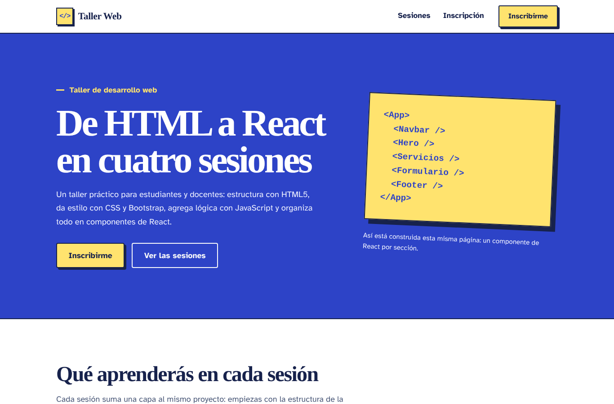
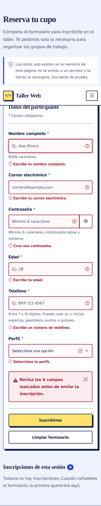

# Landing Page con React y Bootstrap

Landing page de un **Taller de desarrollo web** construida con **React** y **Bootstrap 5**. La interfaz está organizada en componentes funcionales y tiene integrado el formulario de inscripción desarrollado en la Guía Práctica N.º 1, ahora controlado con `useState`, con eventos de React, validaciones mejoradas y mensajes dinámicos de error y éxito.

Práctica N.º 2 de la asignatura Desarrollo Web — Unidad 2: Frameworks de desarrollo de aplicaciones web y móviles (React + framework CSS).



## Tecnologías utilizadas

| Tecnología | Uso en el proyecto |
| --- | --- |
| React 19 | Componentes funcionales, JSX, props y manejo de estado con `useState`, `useEffect` y `useRef`. |
| Vite | Creación del proyecto, servidor de desarrollo y build de producción. |
| Bootstrap 5.3 | Sistema de columnas (`container`, `row`, `col-*`), navbar, botones, formularios, validación visual (`is-invalid`, `is-valid`, `invalid-feedback`), alertas, tabla, badges y barra de progreso. |
| Bootstrap Icons | Íconos de la interfaz. |
| CSS3 | Tema propio sobre las variables CSS de Bootstrap (colores, tipografía y sombras de la Guía 1). |
| JavaScript (ES6+) | Reglas de validación, expresiones regulares y manejo de datos. |
| oxlint | Revisión estática del código (`npm run lint`). |

## Estructura de componentes

```
App
├── Navbar          Barra de navegación fija, menú colapsable y enlace activo según la sección visible
├── Hero            Presentación del taller y llamados a la acción
├── Servicios       Las cuatro sesiones del taller (generadas con .map())
├── Formulario      Formulario de inscripción de la Guía 1, ahora en React
│   ├── Campo           Envoltorio reutilizable: etiqueta, ayuda y mensaje de error
│   └── TablaRegistros  Inscripciones guardadas durante la sesión
└── Footer          Pie de página con enlaces a las secciones
```

## Funcionalidades implementadas

### Sesión 1 — React
- Proyecto React creado con Vite.
- Landing page dividida en componentes funcionales: `Navbar`, `Hero`, `Servicios`, `Formulario` y `Footer`.
- Interfaz escrita en JSX; el contenido (sesiones y perfiles) vive en `src/data/contenido.js` y se recorre con `.map()`.
- Formulario de la Guía 1 incorporado como componente, con los mismos campos: nombre, correo, contraseña, edad, teléfono y perfil.

### Sesión 2 — Bootstrap
- Bootstrap instalado con npm e importado en `src/main.jsx`.
- Componentes de Bootstrap: navbar, botones, formularios, input group, alertas, tabla, badges y barra de progreso.
- Diseño responsivo con el sistema de columnas: el formulario pasa de una a dos columnas, las sesiones de una a cuatro y el menú se colapsa en pantallas pequeñas.

### Sesión 3 — Estados y validaciones
- `useState` para los datos del formulario, los errores por campo, los campos visitados, el mensaje general, la visibilidad de la contraseña y la lista de inscripciones.
- Eventos: `onChange` (actualiza el estado y revalida), `onBlur` (valida al salir del campo), `onSubmit` (valida todo y guarda) y `onClick` (limpiar, mostrar contraseña, quitar inscripción y abrir el menú).
- Mensajes dinámicos: errores debajo de cada campo, alerta general de error con el número de campos a revisar y alerta de éxito con el nombre de la persona.
- Al enviar con errores, el foco se mueve al primer campo inválido.
- Las inscripciones válidas se muestran en una tabla y se pueden quitar.

## Validaciones

| Campo | Regla (Guía 1) | Mejora en esta práctica |
| --- | --- | --- |
| Nombre | Obligatorio, entre 2 y 60 caracteres. | Solo letras (con tildes y ñ), espacios, apóstrofos y guiones; se eliminan espacios repetidos; contador de caracteres. |
| Correo | Obligatorio, con formato de correo. | Exige dominio con extensión (`nombre@dominio.com`) y no permite repetir un correo ya inscrito en la sesión. |
| Contraseña | Obligatoria, mínimo 8 caracteres. | Debe combinar letras y números; indicador de seguridad (débil, media, fuerte) y botón para mostrarla u ocultarla. |
| Edad | Obligatoria, entero entre 1 y 120. | Mensajes separados para decimales, valores menores al mínimo y mayores al máximo. |
| Teléfono | Obligatorio, entre 7 y 15 dígitos; permite `+` inicial, espacios, paréntesis, puntos y guiones. | Se conserva la regla y se normalizan los espacios al guardar. |
| Perfil | Selección obligatoria (Estudiante, Docente u Otro). | Se valida en cuanto cambia la selección. |

Las reglas están en `src/utils/validaciones.js`.

> Los datos solo existen en la memoria de la página: no se envían a un servidor y se borran al recargarla. La contraseña se valida, pero no se guarda en la lista de inscripciones. Usa datos de prueba.

## Instalación y ejecución

Requisitos: [Node.js](https://nodejs.org/) 20.19 o superior y npm.

```bash
# 1. Clonar el repositorio
git clone https://github.com/Diana-avila-v/formulario-web-html-css-javascript.git
cd formulario-web-html-css-javascript

# 2. Instalar dependencias
npm install

# 3. Iniciar el servidor de desarrollo
npm run dev
```

El navegador se abre solo en `http://localhost:5173`. Si no se abre, entra a esa dirección manualmente.

En VS Code también puedes ejecutarlo sin escribir comandos: menú **Terminal → Ejecutar tarea… → npm → npm: install** y, al terminar, **npm: dev**.

Otros comandos:

```bash
npm run build     # genera la versión de producción en dist/
npm run preview   # sirve la versión de producción
npm run lint      # revisa el código con oxlint
```

## Estructura del proyecto

```
├── docs/                    Capturas usadas en este README
├── guia-1/                  Formulario original de la Guía 1 (HTML, CSS y JavaScript)
├── public/
│   └── favicon.svg
├── src/
│   ├── components/
│   │   ├── Navbar.jsx
│   │   ├── Hero.jsx
│   │   ├── Servicios.jsx
│   │   ├── Formulario.jsx
│   │   ├── Campo.jsx
│   │   ├── TablaRegistros.jsx
│   │   └── Footer.jsx
│   ├── data/
│   │   └── contenido.js     Textos de las sesiones y opciones de perfil
│   ├── utils/
│   │   └── validaciones.js  Reglas de validación del formulario
│   ├── App.jsx              Componente raíz y estado de las inscripciones
│   ├── index.css            Tema propio sobre Bootstrap
│   └── main.jsx             Punto de entrada; importa Bootstrap
├── index.html
├── package.json
└── vite.config.js
```

## Vista en móvil


